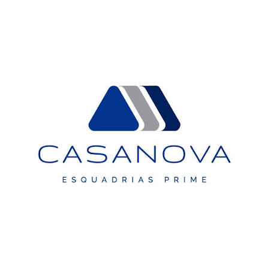
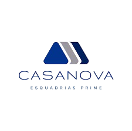

<div align="center">



# Casanova System

### Plataforma de gestão e rastreabilidade de produção para a indústria de esquadrias

**Do estoque de matéria-prima à expedição — cada peça rastreada em tempo real.**

<br/>

[](https://www.python.org/)
[](https://www.djangoproject.com/)
[](https://www.postgresql.org/)
[](https://getbootstrap.com/)
[](https://nginx.org/)
[](https://gunicorn.org/)
[](https://www.django-rest-framework.org/)

[]()
[]()
[]()

<sub>🇧🇷 <b>Português</b> · <a href="#-english">🇺🇸 English</a></sub>

</div>

---

## Sobre o projeto

O **Casanova System** é a plataforma interna que opera a produção da **Casanova Esquadrias** — indústria de esquadrias de alumínio e vidro. Ele resolve um problema concreto de chão de fábrica: **saber onde está cada peça, em que etapa, desde quando, e por quê ela parou.**

Em vez de fichas de papel ou planilhas, cada Ordem de Produção recebe uma etiqueta com **QR Code + código de barras**, e cada setor registra a passagem da peça com uma leitura. O resultado é rastreabilidade completa, indicadores de gargalo e custo real por obra.

> Este repositório é **privado** e o código-fonte é proprietário. O README documenta a arquitetura, as decisões de engenharia e o domínio de negócio.

---

## Desafios de engenharia resolvidos

Estes são os pontos não-triviais do sistema — o que exigiu decisão de arquitetura, não só código.

### 🔄 Fluxo de duplo bip com validação de sequência

O problema real: um setor não pode "segurar" a peça enquanto o próximo está lotado, e ninguém pode pular etapas.

A solução foi um fluxo de **duplo registro por setor**: o primeiro bip inicia o trabalho (entrada), o segundo finaliza e **libera a peça** para o próximo setor. O sistema recusa qualquer leitura fora de ordem, garantindo que a sequência do fluxo produtivo seja respeitada mesmo com operadores diferentes em cada etapa.

```
1º bip  →  entrada no setor   →  aguardando_saida = False
2º bip  →  saída / liberação  →  aguardando_saida = True
```

Cada movimentação guarda **usuário e horário de início e de fim separadamente** — porque quem começa o trabalho frequentemente não é quem termina, e a responsabilidade precisa ficar registrada.

### 📷 QR Code + código de barras na mesma etiqueta

Cada setor tem equipamento diferente. A etiqueta impressa atende aos dois mundos:

| Código | Conteúdo | Quem usa |
|---|---|---|
| **QR Code** | JSON estruturado completo da OP (id, obra, esquadria, descrição, medidas, quantidade) | Câmera de celular e tablet |
| **Code 128** | ID numérico da OP | Leitor laser industrial |

Um único parser extrai o ID de ambos os formatos, então a rotina de registro é a mesma independente do dispositivo de leitura.

### 🔒 HTTPS interno com autoridade certificadora própria

A câmera do navegador só funciona em **contexto seguro** (HTTPS). Em rede interna, sem domínio público, não existe certificado comercial possível — e um certificado autoassinado mantém o aviso "Não seguro" para sempre.

A solução foi uma **CA local da empresa** que assina o certificado do servidor. Cada dispositivo instala a CA **uma vez** e passa a ter conexão confiável — liberando a câmera sem sacrificar a segurança. O sistema inclui uma página de instalação guiada por plataforma (Windows, Android, iOS e Firefox), já que cada uma tem um fluxo distinto.

### 🧩 Integração com ERP corporativo (SQL Server)

O cadastro de Ordens de Produção é sincronizado com o **ERP Faktory** (Microsoft SQL Server) via `mssql-django`, evitando digitação duplicada e mantendo a engenharia e a fábrica sobre a mesma fonte de verdade. Há também importação de planilhas Excel com parsing de dados técnicos das peças.

### 📱 Decisão: uma tela responsiva em vez de um app

O sistema começou com um aplicativo Flutter. Ele foi **deliberadamente removido** em favor de uma única tela web responsiva, com três ganhos concretos:

- **41 MB menos** de bundle para carregar em rede de fábrica
- **Fim dos problemas de cache** do service worker no Safari iOS, que atrasavam a entrega de correções
- **Uma base de código** em vez de duas, mantendo PC e celular sempre idênticos

O leitor de QR Code pela câmera foi movido para o navegador (servido localmente, sem dependência de CDN — a fábrica não depende de internet). Quem tem o atalho antigo é redirecionado automaticamente.

---

## Fluxo produtivo

O sistema acompanha cada OP através de sete etapas:

```
┌──────────┐   ┌───────────┐   ┌───────┐   ┌──────────┐   ┌──────┐   ┌────────────────┐   ┌────────────┐
│ Estoque  │ → │ Separação │ → │ Corte │ → │ Usinagem │ → │ Mesa │ → │ Encaixilhamento│ → │ Expedição  │
└──────────┘   └───────────┘   └───────┘   └──────────┘   └──────┘   └────────────────┘   └────────────┘
                                                                       ↑ opcional
```

**Encaixilhamento** é aplicado apenas a produtos com vidro — decisão registrada na etapa de **Mesa**, que é o ponto onde o sistema já sabe a configuração final da peça.

---

## Módulos

| Módulo | O que faz |
|---|---|
| **Indústria** | Ordens de Produção, rastreio por QR/barcode, tela de produção para o operador, impressão de etiquetas |
| **Frete** | Importação de PDF de frete, cálculo de custo, vínculo com obra |
| **Obras** | Cadastro de obras, múltiplas OPs por obra, acompanhamento de progresso |
| **Veículos** | Frota própria, vínculo com expedições |
| **Custos** | Apuração de custo por OP e por obra |
| **Usuários e Permissões** | Controle de acesso por perfil e por rotina, com auditoria de quem executou cada etapa |
| **Gráficos** | Indicadores visuais de custo e produção |
| **Relatórios** | Fechamento mensal de fretes, histórico de movimentações |
| **API REST** | Endpoints autenticados para integrações e dispositivos |

---

## Arquitetura

```
                        ┌──────────────────────────────────────────┐
                        │              CLIENTES                    │
                        │  Navegador (PC)  ·  Celular/Tablet       │
                        │  Leitor laser    ·  Integrações API      │
                        └────────────────────┬─────────────────────┘
                                             │  HTTPS
                        ┌────────────────────▼─────────────────────┐
                        │              NGINX  (1.28)               │
                        │  TLS · proxy reverso · estáticos         │
                        └────────────────────┬─────────────────────┘
                                             │
                        ┌────────────────────▼─────────────────────┐
                        │       GUNICORN  →  DJANGO 5.2            │
                        │                                          │
                        │  ┌────────────┐  ┌─────────────────────┐ │
                        │  │   Views    │  │   Django REST       │ │
                        │  │   + regras │  │   Framework (API)   │ │
                        │  │  de negócio│  └─────────────────────┘ │
                        │  └─────┬──────┘                          │
                        │        │  ORM                            │
                        └────────┼─────────────────────────────────┘
                                 │
              ┌──────────────────┼──────────────────┐
              │                  │                  │
     ┌────────▼────────┐ ┌───────▼────────┐ ┌───────▼────────────┐
     │   PostgreSQL    │ │  SQL Server    │ │   Arquivos         │
     │  (dados do      │ │  ERP Faktory   │ │   (mídia,          │
     │   sistema)      │ │  (OPs / engenh.)│ │   etiquetas)       │
     └─────────────────┘ └────────────────┘ └────────────────────┘
```

---

## Stack

| Camada | Tecnologia |
|---|---|
| **Backend** | Python 3.14 · Django 5.2 · Django REST Framework |
| **Banco principal** | PostgreSQL 16 |
| **Integração ERP** | Microsoft SQL Server via `mssql-django` + `pyodbc` |
| **Frontend** | Django Templates · Bootstrap 5 · JavaScript (vanilla) |
| **Leitura de códigos** | `qrcode` (QR) · `python-barcode` (Code 128) · `html5-qrcode` (câmera) |
| **Servidor** | Gunicorn + Nginx · systemd |
| **Segurança** | CA local, TLS 1.2/1.3, CSRF, permissões por rotina |
| **Documentos** | `openpyxl` (Excel) · `pdfplumber` / `pypdfium2` (PDF) |

---

## Estrutura do projeto

```
casanova/
├── core/                        # Aplicação principal
│   ├── models.py                # 13 modelos de domínio
│   ├── views/                   # Regras de negócio, separadas por domínio
│   │   ├── rastreio.py          #   fluxo produtivo e duplo bip
│   │   ├── ordem_producao.py    #   OPs, etiquetas, importação
│   │   ├── certificado.py       #   distribuição da CA local
│   │   ├── frete.py  custo.py  veiculo.py  usuario.py  permissao.py
│   │   └── relatorio.py  grafico_frete.py
│   ├── templates/               # 37 templates
│   ├── static/                  # CSS, JS, imagens, bibliotecas
│   │   ├── css/casanova.css     #   design system (tema claro/escuro + paletas)
│   │   └── js/html5-qrcode.min.js
│   ├── migrations/              # 39 migrações versionadas
│   ├── api.py                   # Endpoints REST
│   └── middleware.py            # Detecção de dispositivo
├── setup/                       # Configuração do projeto
│   ├── settings.py
│   ├── urls.py                  # Inclui o roteamento de mídia
│   └── wsgi.py
├── mobile/                      # Build Flutter legado (descontinuado — ver acima)
├── requirements.txt
└── DEPLOY_FAKTORY.md            # Notas de deploy da integração com o ERP
```

**Números do código:** ~5.900 linhas de Python · 53 rotas · 13 modelos · 37 templates · 39 migrações.

---

## Como executar

### Pré-requisitos

- Python 3.14+
- PostgreSQL 16+
- *(Opcional)* Driver ODBC 18 for SQL Server — apenas para a integração com o ERP

### Instalação

```bash
# 1. Clonar
git clone https://github.com/casanova-system/casanova.git
cd casanova

# 2. Ambiente virtual
python -m venv .venv
source .venv/bin/activate        # Linux/macOS
.venv\Scripts\activate           # Windows

# 3. Dependências
pip install -r requirements.txt

# 4. Configuração — criar .env na raiz com as credenciais
#    DB_NAME, DB_USER, DB_PASSWORD, DB_HOST, DB_PORT, SECRET_KEY
#    (e as variáveis FAKTORY_* para a integração com o ERP)

# 5. Banco de dados
python manage.py migrate
python manage.py createsuperuser

# 6. Executar
python manage.py runserver 0.0.0.0:8000
```

### Produção

```bash
gunicorn setup.wsgi:application --bind 0.0.0.0:8000 --workers 4
```

O Nginx atua como proxy reverso e serve estáticos e mídia. Em produção, `DEBUG=False` exige que `/media/` seja roteado explicitamente (ver `setup/urls.py`) e que o serviço seja reiniciado após `collectstatic`.

---

## API REST

Endpoints autenticados para consumo por dispositivos e integrações:

| Método | Endpoint | Descrição |
|---|---|---|
| `POST` | `/api/login/` | Autenticação por token |
| `POST` | `/api/logout/` | Encerramento de sessão |
| `GET` | `/api/perfil/` | Perfil e setor do usuário |
| `GET` | `/api/setores/` | Setores de produção ativos |
| `GET` | `/api/rastreios/` | Lista de OPs em rastreio |
| `GET` | `/api/rastreios/<op_id>/` | Detalhe e histórico de uma OP |
| `POST` | `/api/escanear/` | Registro de movimentação |

---

## Licença

**Proprietário.** Desenvolvido e mantido internamente pela Casanova Esquadrias.
Todos os direitos reservados. Este repositório é privado; o código não é licenciado para uso externo.

---

<div align="center">

<br/>

# 🇺🇸 English

### Production management and traceability platform for the window and door industry

**From raw material to shipping — every unit tracked in real time.**

<br/>

</div>

## About

**Casanova System** is the internal platform that runs production at **Casanova Esquadrias**, a manufacturer of aluminium and glass window and door systems.

It solves a concrete shop-floor problem: **knowing where each unit is, at which stage, for how long, and why it stopped.** Instead of paper sheets or spreadsheets, every production order gets a label with a **QR Code and a barcode**, and each workstation records the hand-off with a single scan.

The result is full traceability, bottleneck detection, and real cost per project.

> This repository is **private** and the source code is proprietary. This README documents the architecture, engineering decisions, and business domain.

## Engineering highlights

**Dual-scan workflow with sequence enforcement.** A workstation cannot hold a unit hostage while the next one is backed up, and no stage can be skipped. The first scan starts work in a sector; the second finishes it and *releases* the unit downstream. Out-of-order scans are rejected. Start and finish are stored with **separate user and timestamp fields**, because the operator who starts a job is often not the one who finishes it — accountability has to survive that.

**QR Code + Code 128 on a single label.** Workstations have different hardware, so the printed label serves both: the QR Code carries structured JSON (full order data) for phone and tablet cameras, while Code 128 carries the numeric ID for industrial laser scanners. One parser extracts the ID from either format, so the registration flow is identical regardless of device.

**Internal HTTPS with a private certificate authority.** Browser cameras only work in a **secure context**. On an internal network with no public domain, a commercial certificate is impossible — and a self-signed one keeps the "Not secure" warning forever. The fix was a **company-local CA** signing the server certificate: each device installs it **once** and gets a trusted connection, unlocking the camera without weakening security. The system ships a guided installation page per platform (Windows, Android, iOS, Firefox), since each has a different trust flow.

**Corporate ERP integration (SQL Server).** Production orders are synchronised with the **Faktory ERP** (Microsoft SQL Server) through `mssql-django`, eliminating double entry and keeping engineering and the shop floor on one source of truth. Excel imports with technical-part parsing are also supported.

**A deliberate architecture decision: one responsive screen instead of an app.** The system started as a Flutter app. It was **intentionally removed** in favour of a single responsive web screen, for three measurable gains: **41 MB less** to load over the factory network; the end of iOS Safari service-worker caching that delayed every fix; and **one codebase** instead of two, keeping desktop and mobile identical. Camera-based QR scanning moved into the browser (served locally — no CDN, so the factory never depends on internet access). Legacy shortcuts redirect automatically.

## Production flow

```
Stock → Picking → Cutting → Machining → Assembly Bench → Glazing* → Shipping
                                                          ↑ optional
```

\* **Glazing** applies only to glass products — decided at the **Assembly Bench** stage, the point where the system knows the final configuration.

## Modules

| Module | Purpose |
|---|---|
| **Manufacturing** | Production orders, QR/barcode traceability, operator screen, label printing |
| **Freight** | PDF import, cost calculation, project linking |
| **Projects** | Project registry, multiple orders per project, progress tracking |
| **Fleet** | Own vehicle fleet, shipping linkage |
| **Costing** | Cost per production order and per project |
| **Users & Permissions** | Access control by profile and by routine, with per-stage audit trail |
| **Charts** | Visual indicators for cost and output |
| **Reports** | Monthly freight closing, movement history |
| **REST API** | Authenticated endpoints for devices and integrations |

## Stack

| Layer | Technology |
|---|---|
| **Backend** | Python 3.14 · Django 5.2 · Django REST Framework |
| **Primary database** | PostgreSQL 16 |
| **ERP integration** | Microsoft SQL Server via `mssql-django` + `pyodbc` |
| **Frontend** | Django Templates · Bootstrap 5 · vanilla JavaScript |
| **Code scanning** | `qrcode` · `python-barcode` · `html5-qrcode` |
| **Serving** | Gunicorn + Nginx · systemd |
| **Security** | Private CA, TLS 1.2/1.3, CSRF, per-routine permissions |
| **Documents** | `openpyxl` · `pdfplumber` / `pypdfium2` |

## Codebase

~5,900 lines of Python · 53 routes · 13 domain models · 37 templates · 39 migrations.

## License

**Proprietary.** Built and maintained internally by Casanova Esquadrias. All rights reserved.

---

<div align="center">
<br/>

<br/>
<sub><b>Casanova Esquadrias</b> — precisão em cada esquadria</sub>
<br/>
<sub>Documentação mantida pela equipe de tecnologia</sub>
<br/><br/>
</div>
